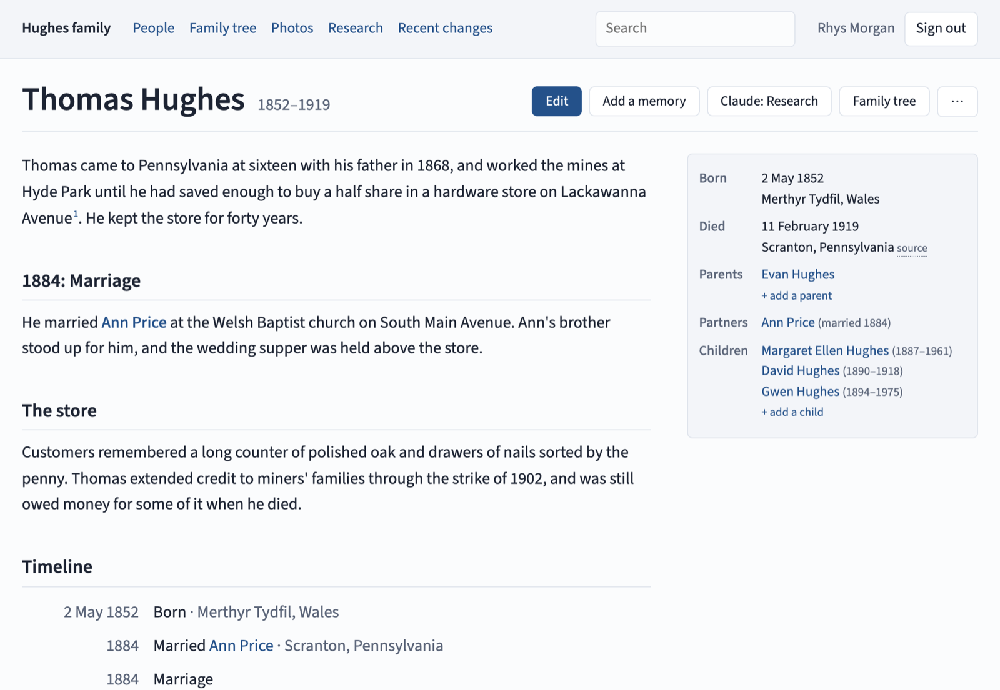
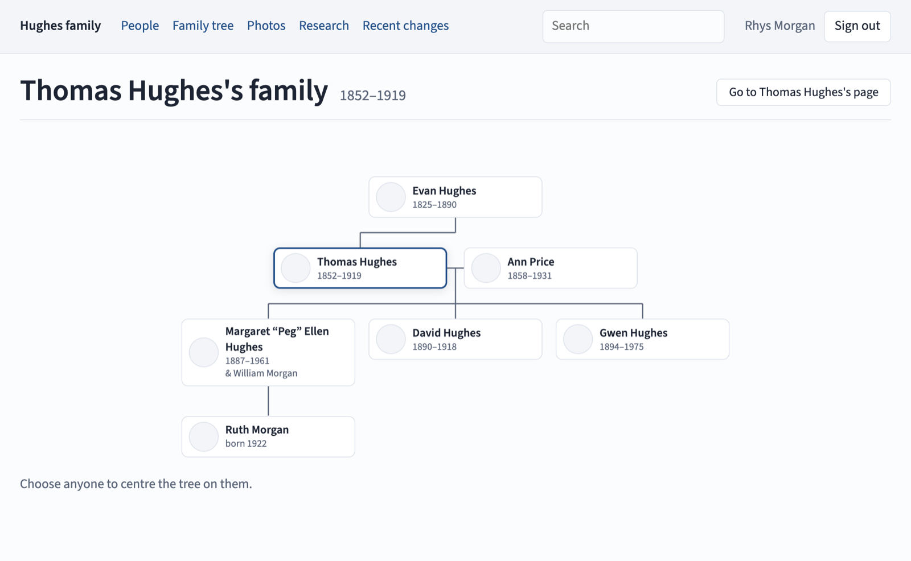
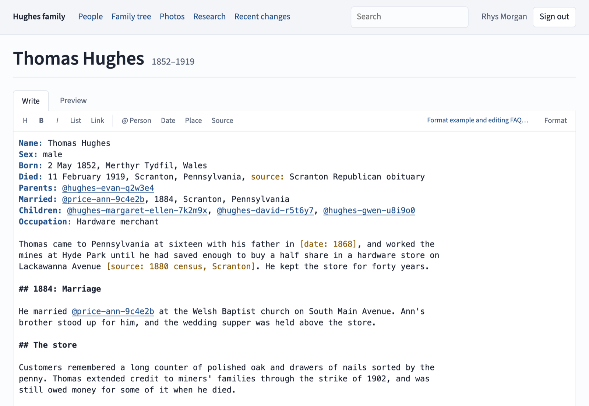

# Prosapia

_Genealogy, in prose._

Prosapia is a family-history wiki. Each person in a family has a page: their story
written as prose, with the facts that matter (dates, places, parents, partners), their
photos, and the sources behind what is known. Relatives sign in with a Google account to
read and edit. Every change is recorded and can be undone, and the whole tree is kept
exportable as plain files that need no special software to read.

_Prosapia_ is Latin for lineage, or family line.

Prosapia is in a private preview with one family's tree and a few invited relatives.

## What it does

**A page for everyone in the family.** Each page is a story first: who they were, where
they lived, what people remember. Beside it, the facts (born, died, parents, partners,
children) with dates and places, and below it a timeline drawn from the facts and from
the dates in the story. Pages link to each other as you would expect.

**A family tree.** A chart of anyone's family: grandparents and parents above, brothers
and sisters beside, partners, children and grandchildren below. Choose anyone to move
the tree onto them. The home page opens on your own family.

**Editing as plain text.** A page is written as a few lines of facts and then ordinary
prose, so a relative can add a story without filling in a form. The editor completes
names and places as you type, shows a preview, and has a guide with a worked example.
Quick actions add a child, partner or parent from a person's page, and check first for
someone similar already in the tree.

**Photos and documents.** Add photos, scanned letters and certificates, or sources with
no file at all, such as an obituary's link and text. Say who is in a photo, when and
where it was taken, and what is written on the back. That information is written into
the photo file itself, so it stays with the photo wherever the file goes.

**Sources.** Any fact or sentence can cite where it came from: a document in the tree,
or a note such as "1880 census". A person's page gathers its sources in one place, a
document's page lists everything that cites it, and a claim can be marked as needing a
source.

**Help from Claude, when you ask.** An owner can switch on help from Claude, an AI
model. It can draft a first biography from what the tree already says, tidy a memory
someone wrote quickly, transcribe handwriting on a photo or a document a page at a time,
and suggest records worth looking for. Nothing it writes is saved until a person reads
it and publishes.

**Every change kept.** Each edit is recorded with who made it and why, can be compared
with the version before, and can be undone. Contradictions between pages (two different
marriage dates, say) are gathered on one page to sort out.

**Private.** Only invited relatives can sign in, with a Google account, as owners,
editors or viewers.

**Yours to keep.** The tree is copied every night to plain files (text and photos) that
any computer can open without Prosapia. Trees from other genealogy software can be
brought in through GEDCOM, the common exchange format.

_The screenshots show an invented family._

## Principles

- **A family's history outlives the software.** Everything is kept as plain text and
  ordinary photo files.
- **Prose first, structure where it pays.**
- **Information travels with its artifact.** What is known about a photo is stored
  inside the photo.
- **Every change is attributed, logged and reversible.**
- **Private by default.**
- **Every claim can cite its source.**
- **Standards at the edges.** GEDCOM for exchanging trees with other software; XMP and
  IPTC for photo metadata.

## Learn more

<!-- prettier-ignore -->
| Document | Covers |
| --- | --- |
| [docs/architecture.md](docs/architecture.md) | How it is built: the system, the technology, storage and versioning, editing, derived views |
| [docs/content-model.md](docs/content-model.md) | What a person's page holds, sources and citations, GEDCOM import and export |
| [docs/media.md](docs/media.md) | Photos: storage formats, embedded metadata, fronts and backs, rolls |
| [docs/sharing.md](docs/sharing.md) | Privacy, sharing and trust (not yet designed in full) |
| [docs/design.md](docs/design.md) | The main decisions and why, and the questions still open |
| [docs/loading.md](docs/loading.md) | Loading a family's existing tree, from other genealogy software, into Prosapia |
| [docs/writing.md](docs/writing.md) | How biographies and change summaries should read, for people and for a language model |
| [docs/journeys.md](docs/journeys.md) | The tasks people come to Prosapia to do, and what a forgiving version looks like |
| [docs/plan.md](docs/plan.md) | What is being built next, known future work, and a changelog |

## Contributing

[CONTRIBUTING.md](CONTRIBUTING.md) covers running Prosapia locally, the checks a change
must pass, and how work is organised.

## License

BSD 3-Clause; see [LICENSE](LICENSE).
