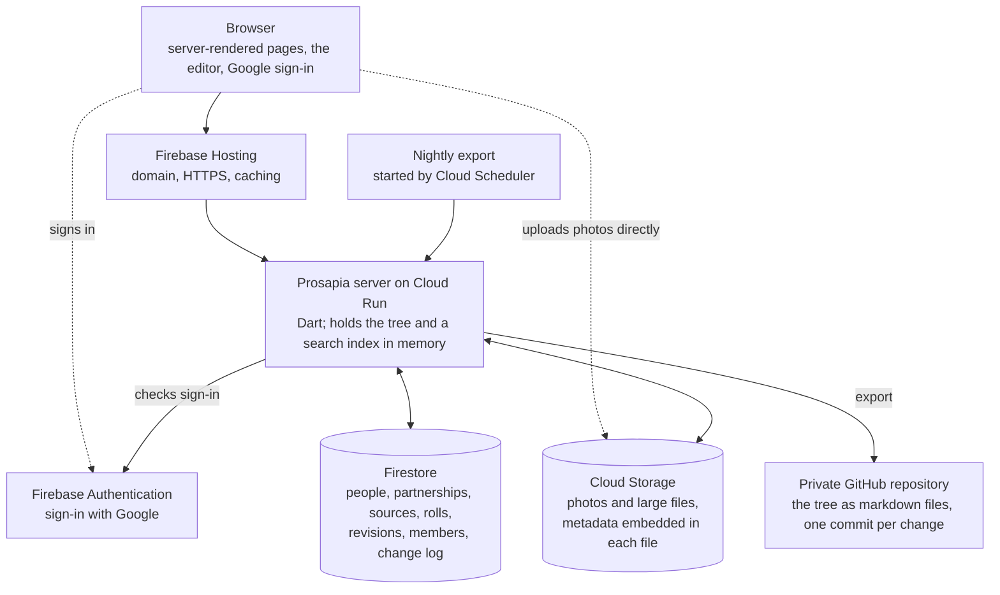

# Architecture

## System overview

Prosapia is a hosted web app: a server sits between the people using it and a database,
and everything a reader sees is computed from that database.



Only the server reads and writes the database. The browser talks to Google directly for
two things: signing in, and uploading photos, so large files do not pass through the
server.

## Technology stack

Direction set:

<!-- prettier-ignore -->
| Part | Choice |
| --- | --- |
| Server | Dart, in a container on Cloud Run. Renders pages as HTML. Scales to zero when idle |
| Front door | Firebase Hosting: custom domain, HTTPS, caching; forwards page requests to the server |
| Browser | TypeScript. Pages are server-rendered HTML; the editor is the one substantial browser-side component |
| Sign-in | Firebase Authentication with Google accounts |
| Region | `us-west1` for the database, storage and the server |
| Records | Firestore |
| Photos and large files | Cloud Storage for Firebase |
| Search and relationship lookups | An in-memory SQLite index with full-text search, built when the server loads the tree |
| Image encoding and metadata | Command-line tools in the server's container: `exiftool` for metadata, `libvips` for JPEG encoding and display copies |
| GEDCOM | Prosapia's own reader and writer |
| Backup | Firestore's scheduled backups, plus a nightly export to a private GitHub repository |
| Local development | Firebase's emulators, or a tree loaded from files |

Dart on the server was the known risk, and a spike retired it: Firebase publishes an
official Admin SDK for Dart (`firebase_admin_sdk`), and Firestore, sign-in verification,
session cookies and Cloud Storage all worked from it against the local emulators. See
[spikes/firebase](../spikes/firebase/README.md). The SDK is young (version 0.5), so the
fallback remains TypeScript for both server and browser.

A billing account is required: Cloud Run and Cloud Storage need the pay-as-you-go plan.
One family's usage should sit within the free allowances or cost very little.

## Storage and versioning

Direction set: the database is the record. Each tree's people, partnerships, sources and
rolls are Firestore documents; photos and large files are objects in Cloud Storage. Git
and GitHub are no longer the store: most relatives have a Google account and no GitHub
account, and Prosapia would have had to build its own sign-in and editing screens in any
case.

```
trees/{tree}
  members/{google account}     role: owner, editor or viewer
  people/{p-7k2m9x}            the page as written; a deleted page is marked so
    revisions/{revision}       every saved version: text, author, time, summary
  sources/{s-1900-census}
  rolls/{r-8d2k5n}
  media/{m-5t1q8z}             where the file is, and what it says about itself
  changes/{change}             the log: who changed what, when, and why
```

### The file layout remains, as the import and export format

The markdown layout designed earlier is still Prosapia's portable form. It is what the
nightly export writes, what an import reads, and what the server loads in local
development and tests.

```
tree/
  people/
    hughes-margaret-ellen-7k2m9x/
      index.md     (the person's page)
  sources/   s-1900-census.md
  media/
    m-5t1q8z.jpg        (a photo's front)
    m-5t1q8z-back.jpg   (its back)
  rolls/     r-8d2k5n.md   (an optional group of related photos)
  tree.yaml  (tree name and settings)
```

### Decisions

- **Only the server touches the database.** The store sits behind one interface in the
  server, with two implementations: Firestore in production, files for development and
  tests. Changing the store later is a contained change.
- **Every save writes a revision**: the full text, the author, the time and a one-line
  summary. Nothing is overwritten.
- **A page has one text form**: its facts as a short block, then markdown. The editor
  edits that text, a revision stores it, and the export writes it to a file, so all
  three always agree.
- **Every change is logged.** The change log lists who changed which pages and why. It
  drives the recent-changes view and the export.
- **Relationships as stated.** A relationship may be stated on either person's page, as
  described in
  [content-model.md](content-model.md#people-and-relationships-in-the-text); the server
  combines both sides. Descendants and other longer relationships are derived, not
  stored.
- **The server caches the tree in memory.** On start it loads the tree and builds the
  search index, as it does from files today. Each tree carries a version number; a
  server instance that sees a newer one reloads. This is enough for any near or
  medium-term size.
- **Photos live in Cloud Storage**, stored as they are with their metadata embedded. The
  browser uploads directly; the server then writes the metadata into the file.
- **Display copies are derived and never stored as originals.** The server makes resized
  web copies on demand. Cloud Run has no lasting disk, so they are cached by Firebase
  Hosting or in a cache folder in the bucket.

### Backup and export

- **Firestore's scheduled backups** cover disaster recovery.
- **A nightly export writes the tree, in the file layout above, to a private GitHub
  repository.** It is readable without Prosapia. Because every change is logged, the
  export writes one commit per change with its real author, so the history carries over.
- **GEDCOM is produced alongside** for other genealogy tools. It loses too much prose to
  serve as the backup.

This keeps the original aim that a family's history outlives the software, by a
different route: the files are a continuous export, not the live store.

### Open

- **Removing something for good.** A living person who asks to be removed, or a secret
  published by mistake, must be deleted from the revisions and the change log, and from
  the exported repository's history. This needs a defined procedure.
- **One tree or many.** If two cousins each keep a tree and share ancestors, are those
  the same person record, a link, or a copy?
- **Large trees.** Loading a whole tree into memory stops working somewhere. Where, and
  what replaces it, can wait.
- **Whether the export should run on every change** rather than nightly, so the files
  never lag.

## Editing

Direction set: editing feels like Wikipedia. Anyone with write access changes a page
directly; there is no review step. Safety comes from the log: every edit is recorded,
attributed and reversible.

1. A signed-in editor presses Edit on a page.
2. They change the page and write a one-line summary.
3. Saving stores a new revision and adds an entry to the change log. The page updates at
   once.
4. The page's history lists every revision with author, date and summary. Any two can be
   compared, and any earlier one restored.

Dropping review removes the hardest part of the design: proposals, a review screen, and
merging a proposal against a page that has moved on. It can return later as an option
for larger families.

### Roles

| Role   | Can do                                                  |
| ------ | ------------------------------------------------------- |
| Owner  | Everything, including inviting people and setting roles |
| Editor | Edit any page, add photos, restore earlier versions     |
| Viewer | Read                                                    |

People are invited by email address and sign in with Google. Prosapia keeps the member
list; Google only confirms who someone is.

### Decided by the brief

- It is always possible to see what changed and who changed it.
- Practices are borrowed from Wikipedia where they fit.

### Proposed

<!-- prettier-ignore -->
| Feature | In Prosapia |
| --- | --- |
| Page history | Every page lists its revisions; any two can be compared |
| Restore | An editor can bring back an earlier version; that is itself a new revision |
| Recent changes | One list of every edit across the tree, newest first |
| Blame | For any sentence or fact: who added it and when |
| Talk page | A discussion thread per person, for questions such as "is this the right Thomas?" |
| Citation needed | Uncited claims are marked, not blocked |
| Watchlist | Follow a person and hear about changes to their page |

- **Imports and bulk changes are previewed before they are applied**, and land as one
  logged change that can be undone as a whole.
- **Adding an entry is the easy path.** "Add a memory" appends a dated section and
  photos without touching the rest of the page.
- **A save checks the page has not changed underneath.** If someone else saved first,
  the editor is shown their change and asked to reapply, rather than silently
  overwriting it.

### Open

- **The editing surface.** Raw markdown, a formatted editor that writes markdown, or
  both. Most relatives will not write markdown.
- **Whether some families will want review back**, at least for new members.
- **Contributions from people who are not members**, such as a great-aunt replying to a
  link with a correction.

## Derived views

Nothing a reader sees beyond the page text is stored; it is computed from the tree. This
is what lets a contributor add a loose entry and leave the system to work out where it
shows up.

| View                                   | Built from                                                   |
| -------------------------------------- | ------------------------------------------------------------ |
| Person page                            | The markdown body, with an infobox from the structured facts |
| Life timeline                          | Structured events plus dated entry headings                  |
| Family tree and descendant charts      | Parent links and partnership records                         |
| Photo gallery per person               | Names embedded in image metadata                             |
| Sources list and "needs source" report | Citations on facts and footnotes                             |
| Search                                 | Page text, names, places and image metadata                  |
| Recent changes                         | The change log                                               |
| GEDCOM export                          | Structured facts, sources and media                          |

### Decided by the brief

- Incorporating loosely added information into fuller views is the responsibility of
  viewing and summary systems, not the person editing.

### Proposed

- **Views never write to the tree on their own.** A generated summary that should become
  part of a page is offered to an editor, who saves it as an ordinary edit under their
  name.
- **The index is disposable.** It is rebuilt whenever the server loads the tree.

### Open

- **Generated summaries.** Whether a language model drafts a biography or suggests
  structured facts from prose, and how its output is labelled and cited.
- **Static or live.** Public pages could be published as a static site; private ones
  need access checks on every request.
- **Printing.** Family books and wall charts are a common end product; in scope or
  later?
