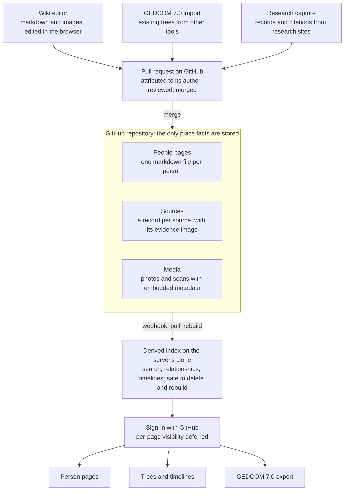

# Architecture

## System overview

Everything that enters Loom becomes an attributed change to one repository, and everything a reader sees is computed from that repository.



The repository is a GitHub repository, and the server works on a clone of it. Early versions require a GitHub account with access to the repository, and everyone with access sees everything. Per-page visibility is deferred with the sharing model.

## Technology stack

Direction set: the server is written in Dart and the browser code in TypeScript. If Dart's libraries prove too thin, the fallback is TypeScript for both.

| Part | Choice |
| --- | --- |
| Server | Dart. Renders pages as HTML, works on the clone, talks to GitHub |
| Browser | TypeScript. Pages are server-rendered HTML; the editor is the one substantial browser-side component |
| Derived index | SQLite, with its built-in full-text search |
| Git | The `git` command line, run on the clone |
| Image encoding and metadata | Command-line tools run by the server: `exiftool` for metadata, an image tool for JPEG encoding and display copies |
| GEDCOM 7.0 | Loom's own reader and writer |

Known risks of Dart on the server, to test early: GitHub sign-in, pull requests and webhooks need more hand-written code than in TypeScript, and an edit must change only the lines the person touched, which needs source-preserving markdown edits. Both are exercised by milestone 3 in the [plan](plan.md).

## Storage and versioning

Direction set: the store is a GitHub repository, one per family tree. The Loom server and editor run on a clone of it; changes go upstream as pull requests, are reviewed, and are merged. Git already provides history, authorship, branching, review and offline copies, and a tree stays readable with no Loom software at all.

```
tree/
  people/
    p-7k2m9x/
      index.md     (the person's page)
  unions/    u-2b6n4c.md
  sources/   s-1900-census.md
  media/
    m-5t1q8z.jpg        (a photo's front)
    m-5t1q8z-back.jpg   (its back)
  rolls/     r-8d2k5n.md   (an optional group of related photos)
  loom.yaml  (tree name and settings)
```

### Decided by the brief

- Every change is versioned and attributed to a person.
- Incoming changes can be reviewed before they are accepted.

### Proposed

- **Contributors never see git.** The editor turns a save into a branch and a pull request on GitHub; an editor's own change can be merged at once.
- **Commits carry the real contributor** as author, even when a server writes them.
- **A derived index sits beside the repository**: search, relationship lookups and timelines. It holds nothing original and can be deleted and rebuilt.
- **One file per person keeps merges small.** Two relatives editing different people never conflict.
- **Contributors sign in with GitHub.** Early versions require a GitHub account with access to the repository. The server opens each pull request on behalf of the signed-in person.
- **The clone follows upstream.** A webhook tells the server when a pull request merges, so it pulls and rebuilds the index.
- **Display copies are derived.** The server generates resized web copies into a cache, and converts the few stored formats browsers cannot show. Like the index, the cache can be deleted and rebuilt.

### Open

- **Where image bytes live.** Scans are large and git handles large binaries poorly. Candidates are Git LFS, git-annex, or a content-addressed store beside the repository with only hashes in git. GitHub caps single files at 100 MB and meters LFS storage and bandwidth, and even compressed scans add up.
- **Removing something from history.** Git keeps everything. A living person who asks to be removed, or a mistakenly published secret, needs a history rewrite. This needs a defined procedure. On GitHub it is harder still: pull request refs keep old commits reachable, so full removal may need GitHub support.
- **One tree or many.** If two cousins each keep a tree and share ancestors, are those the same person record, a link, or a copy?

## Editing and review

Direction set: editing feels like Wikipedia and is recorded on GitHub. A relative presses Edit, changes the page, writes a one-line summary and saves. What happens next depends on their role.

1. The editor opens a page as formatted text with an Edit button, not as raw files.
2. Saving asks for a short summary of the change.
3. An editor's save becomes a pull request they can merge at once.
4. A contributor's save becomes a pull request that waits for an editor.
5. An editor reads the proposal as a before-and-after comparison, then accepts, amends or declines it with a note.
6. Accepted changes appear in the page's history with author, date and summary.

### Decided by the brief

- It is always possible to see what changed and who changed it.
- Incoming changes can be reviewed.
- Practices are borrowed from Wikipedia and GitHub where they fit.

### Proposed

| Borrowed from | Feature | In Loom |
| --- | --- | --- |
| Wikipedia | Page history | Every page lists its changes; any two versions can be compared |
| Wikipedia | Revert | An editor can undo one change without losing later ones |
| Wikipedia | Talk page | A discussion thread per person, for questions such as "is this the right Thomas?" |
| Wikipedia | Citation needed | Uncited claims are marked, not blocked |
| Wikipedia | Watchlist | Follow a person and hear about changes to their page |
| GitHub | Pull request | A contributor's edit waits as a proposal with a comparison view |
| GitHub | Review comments | An editor can comment on a specific line of a proposal |
| GitHub | Blame | For any sentence or fact: who added it, when, and citing what |

- **Imports and bulk changes always go through review**, whoever makes them.
- **Adding an entry is the easy path.** "Add a memory" appends a dated section and photos without touching the rest of the page.

### Open

- **The editing surface.** Raw markdown, a formatted editor that writes markdown, or both. Most relatives will not write markdown.
- **Edit conflicts.** Two people editing the same page at once: merge automatically, warn, or lock.
- **Who reviews when the owner is unavailable**, and whether stale proposals expire.
- **Contributions without a GitHub account**, such as a great-aunt replying to a link with a correction. Not supported in early versions.

## Derived views

Nothing a reader sees beyond the page text is stored; it is computed from the repository. This is what lets a contributor add a loose entry and leave the system to work out where it shows up.

| View | Built from |
| --- | --- |
| Person page | The markdown body, with an infobox from the structured facts |
| Life timeline | Structured events plus dated entry headings |
| Family tree and descendant charts | Parent links and partnership records |
| Photo gallery per person | Names embedded in image metadata |
| Sources list and "needs source" report | Citations on facts and footnotes |
| Search | Page text, names, places and image metadata |
| Recent changes | Repository history |
| GEDCOM 7.0 export | Structured facts, sources and media |

### Decided by the brief

- Incorporating loosely added information into fuller views is the responsibility of viewing and summary systems, not the person editing.

### Proposed

- **Views never write to the repository on their own.** A generated summary that should become part of a page is submitted as a proposed change and reviewed.
- **The index is disposable.** Any view can be regenerated from a fresh clone.

### Open

- **Generated summaries.** Whether a language model drafts a biography or suggests structured facts from prose, and how its output is labelled and cited.
- **Static or live.** Public pages could be published as a static site; private ones need access checks on every request.
- **Printing.** Family books and wall charts are a common end product; in scope or later?
